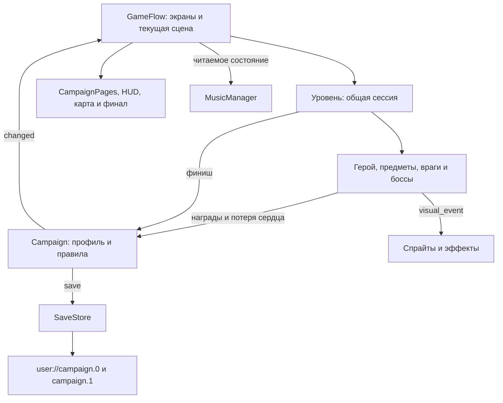

# MARICRAFT — технические материалы для отчёта по программированию

Дата изучения: **7 ноября 2026 года**. Рабочий проект: **D:/Projects/MARICRAFT/project.godot**.

Это источник материалов для будущего университетского отчёта, а не окончательный официальный отчёт. Основание — текущие `.gd`, `.tscn`, ресурсы, настройки и существующий экспорт проекта. Старые планы использованы только для сопоставления. Выполнен статический разбор: игру, импорт, экспорт и игровые тесты в рамках этой документационной задачи не запускали.

Разделы «первого», «второго» и «третьего программиста» обозначают **предлагаемое тематическое распределение материала**. Они не доказывают, кто из участников написал конкретный файл. Подтверждённые сведения о личном авторстве в этот документ не включены.

## 1. Технологии и общая организация кода

### 1.1. Фактическая технологическая основа

| Средство | Как используется именно в MARICRAFT |
|---|---|
| Godot 4.7.2 Standard | Версия соответствует заданию и свойствам локального `godot.windows.opt.tools.64.exe`: `4.7.2.stable.steam`. В `project.godot` указана ветка `4.7`. Номер приложения `config/version="0.7.0"` — отдельный номер игры, не версия движка. |
| GDScript | Игровая логика, меню, сохранения, звуковые менеджеры и инструменты редактора. Используются наследование, сигналы, `enum`, словари, типизированные параметры, `@export`, `@onready`, `preload()` и `load()`. |
| Compatibility | `renderer/rendering_method` и его мобильный вариант имеют значение `gl_compatibility`. Этот режим используется существующей Web-сборкой. |
| Сцены и ресурсы | `.tscn` описывают иерархию узлов и экземпляры объектов; `.tres`, `SpriteFrames`, текстуры, темы и JSON-реестры описывают представление и параметры. |
| CanvasItem shaders | Например, `molten_field_variants.gdshader` смешивает варианты камня по мировым координатам. Это оформление поверхности, не генерация физического уровня. |
| Web-экспорт Godot | HTML-оболочка, JavaScript-загрузчик, WebAssembly-модуль движка и пакет `.pck`. Игровая логика представлена GDScript-кодом в экспортированном проекте; JavaScript-загрузчик запускает движок. |
| Python / PowerShell / JavaScript | Вспомогательные инструменты экспорта, просмотра и тестирования в `tools/` и `tests/`. Они не заменяют игровые контроллеры. Локальный Python HTTP-сервер служит для доставки файлов Web-сборки, а не для расчёта игровой логики. |

Проверяемые файлы: [настройки проекта](D:/Projects/MARICRAFT/project.godot), [настройки экспорта](D:/Projects/MARICRAFT/export_presets.cfg), [движок](D:/Projects/MARICRAFT/reports/temp/engine/godot.windows.opt.tools.64.exe), [шейдер поверхности](D:/Projects/MARICRAFT/scripts/visual/molten_field_variants.gdshader).

**Почему Godot подходит этой реализации.** В игре уже применяются его готовые 2D-тела, запросы к физическому миру, камеры, интерфейсные узлы и сериализация. Один экземпляр `forest_player.tscn` используется во всех главах, а готовые сцены монет, платформ и противников многократно включаются в уровни. `@export` позволяет задавать маршрут платформы, вид бонуса и границы патруля прямо в сцене. Один проект обслуживает настольный и Web-запуск. Это техническое объяснение пригодности движка; историческая причина выбора движка командой по исходникам не устанавливается.

### 1.2. Точка входа и основные каталоги

Стартовая сцена — [campaign.tscn](D:/Projects/MARICRAFT/scenes/boot/campaign.tscn), назначенная в `run/main_scene`. Её корневой `CampaignGame` использует `game_flow.gd`. Старые [start.tscn](D:/Projects/MARICRAFT/scenes/boot/start.tscn), [test_field.tscn](D:/Projects/MARICRAFT/scenes/levels/test_field.tscn) и [test_player.gd](D:/Projects/MARICRAFT/scripts/gameplay/test_player.gd) не являются обычной точкой входа актуальной кампании.

| Каталог | Роль |
|---|---|
| `D:/Projects/MARICRAFT/scripts/core/` | Состояние кампании, хранение, переходы между экранами, звук, общие элементы UI. |
| `D:/Projects/MARICRAFT/scripts/gameplay/` | Физика героя, уровни, противники, боссы, предметы, опасности, камера. |
| `D:/Projects/MARICRAFT/scripts/ui/` | Компоновка экранов, выбор героя, темы, значки и оформление интерфейса. |
| `D:/Projects/MARICRAFT/scripts/visual/` | Подключение спрайтов, анимаций, фонов, поверхности и эффектов к игровым объектам. |
| `D:/Projects/MARICRAFT/scenes/` | Старт, девять уровней, персонаж, противники и переиспользуемые объекты. |
| `D:/Projects/MARICRAFT/assets/` | Не только изображения и звук: здесь также находятся код карты/финала, визуальные сцены и адаптер Рагнароса. |
| `D:/Projects/MARICRAFT/addons/maricraft_levels/` | Редакторский предпросмотр уровней и выбор/перемещение объектов с Undo/Redo. |
| `D:/Projects/MARICRAFT/scripts/debug/`, `tests/`, `qa/`, `tools/` | Диагностика и инструменты разработки. Их назначение нужно отделять от публичного игрового процесса. |

При просмотре найдено 80 GDScript-файлов в `scripts/`, 15 в `assets/`, 3 в `addons/` и 34 сцены в `scenes/`. Эти количества включают вспомогательные и старые прототипные файлы; они **не означают**, что все файлы одновременно участвуют в игре. Отдельно есть стартовый `scenes/boot/start.gd` и тестовые скрипты.

### 1.3. Организация сцены во время игры

Упрощённая иерархия, соответствующая `campaign.tscn`, `GameFlow.start_level()` и сцене героя:

```text
/root
├── Campaign                   Autoload: профиль и правила кампании
├── SFX                        Autoload: звуковые эффекты
├── MusicManager               Autoload: музыкальные темы
├── DebugTools                 Autoload; в release удаляет себя
└── CampaignGame               Node, game_flow.gd
    ├── Interface              CanvasLayer
    │   ├── Screen             Control: текущая страница или HUD
    │   └── Feedback           Label: сообщения сохранения/тестового режима
    └── экземпляр уровня       Node2D, добавляется start_level()
        ├── Player             CharacterBody2D
        │   ├── Hitbox         CollisionShape2D
        │   ├── Camera         Camera2D
        │   └── Skin           визуальная ветвь, подключается при запуске
        ├── платформы, предметы, противники, Boss/Gate при наличии
        ├── Scenery            авторские декорации
        └── ForestArt / LocationArt и дополнительные визуальные узлы
```

`GameFlow` создаёт уровень из словаря `LEVELS` через `PackedScene.instantiate()` и `add_child()`. При переходе удаляет предыдущий мир через `remove_child()` и `queue_free()`. Интерфейс остаётся в `CanvasLayer`, поэтому движения и масштаб мировой камеры не меняют размеры HUD.

Общая схема ответственности:



### 1.4. Как компоненты взаимодействуют

1. **Autoload.** `Campaign`, `SFX`, `MusicManager`, `DebugTools` перечислены в настройках проекта. `Campaign` остаётся доступен при смене уровня; данные не приходится переносить из уничтожаемой сцены вручную.
2. **Сигналы.** `Campaign.changed` связан с `GameFlow.refresh`; `level.cleared` открывает экран результата; `visual_event` связывает механику с анимациями. Карта отправляет `level_selected` и `start_requested`, а не начисляет деньги самостоятельно.
3. **Группы.** `forest_player` используется для поиска героя, `bolts` — для ограничения его снарядов, `boss_shots`, `molten_attacks`, `enemy_projectiles`, `mine_strikes` — для разных типов атак и их очистки.
4. **Прямые ссылки и соглашения.** Враги получают героя через `get_parent().player`, код уровня обращается к `$Player` и `$Gate`. Общая обработка снаряда проверяет методы `magic_hit()` и `defeat()`. Это конкретные договорённости между скриптами, а не отдельная универсальная система компонентов.
5. **Наследование и композиция.** `durotar_level.gd` и `molten_level.gd` наследуют `forest_level.gd`. Стрельба чертёнка подключена отдельным дочерним `imp_attack.gd`, а `fire_imp.tscn` наследует сцену мурлока. Три босса имеют отдельные контроллеры с похожими состояниями.

Физические категории, заданные в сценах (числа — битовые маски):

| Объект | Layer / Mask | Практический смысл |
|---|---|---|
| Мир и платформы | 1 / обычно 1 либо 0 у преград | Геометрия, на которой стоит герой. |
| Герой | 2 / 1 | Движение ограничено миром; контактный урон врагов вычисляется их скриптами. |
| Мурлок и кобольд | 4 / 1 | Их физические тела ходят по миру; боковое касание героя и удар сверху дополнительно проверяются координатами. |
| Болт героя | 0 / 5 | Проверяет мир `1` и врагов `4`. |
| Снаряды врагов | 0 / 3 | Проверяют мир `1` и героя `2`. |
| Монета (`Area2D`) | 0 / 2 | Обнаруживает перекрытие с героем, не служит твёрдой стеной. |

Источники: [герой](D:/Projects/MARICRAFT/scenes/actors/forest_player.tscn), [мурлок](D:/Projects/MARICRAFT/scenes/enemies/murloc.tscn), [кобольд](D:/Projects/MARICRAFT/scenes/enemies/kobold.tscn), [болт](D:/Projects/MARICRAFT/scenes/objects/bolt.tscn), [снаряд босса](D:/Projects/MARICRAFT/scenes/objects/boss_shot.tscn), [монета](D:/Projects/MARICRAFT/scenes/objects/coin.tscn).

### 1.5. Web-сборка, настольный запуск и ограничения

В [export_presets.cfg](D:/Projects/MARICRAFT/export_presets.cfg) есть обычный пресет `Web` и отдельный `Web Camera QA`. Для обоих отключены `variant/thread_support` и `variant/extensions_support`, отключён PWA. У обычного пресета исключены `tests`, `qa`, `reports`, `art_source`, `docs`, `tools` и перечисленные неиспользуемые ресурсы. JSON-манифесты явно добавлены в `include_filter`, поскольку игра загружает их по путям.

[export_camera_repair.ps1](D:/Projects/MARICRAFT/tools/export_camera_repair.ps1) выбирает `--export-release` или `--export-debug`, запускает тот же Godot с `--headless --path` и передаёт конечный HTML-путь. Шаблоны находятся в `D:/Projects/MARICRAFT/reports/temp/engine/editor_data/export_templates/4.7.2.stable/`. В рамках подготовки отчёта экспорт не выполнялся.

Проверена существующая папка [exports/arena-polish-release](D:/Projects/MARICRAFT/exports/arena-polish-release/). Она содержит `index.html`, `index.js`, `index.wasm`, `index.pck`, значки и два audio worklet-файла. На дату просмотра `.pck` имеет 102 606 900 байт, `.wasm` — 39 514 754 байта: это размеры локальных файлов, не измерение сетевой загрузки с HTTP-сжатием. В загрузчике присутствуют WebAssembly, WebGL2 и IDBFS/IndexedDB; код сохранения обращается к `user://`.

Браузерная специфика сосредоточена в проверках `OS.has_feature("web")`: блокировка одновременной записи профиля через Web Locks, диагностическое наблюдение по явному флагу страницы, ожидание пользовательского ввода перед звуком. Настольная версия эти браузерные ветви пропускает. `index.html` задаёт `focusCanvas=true`; `GameFlow.focus_page()` назначает фокус первой доступной кнопке или кнопке старта карты.

Практические преимущества и границы решения:

- Общие сцены и правила уменьшают дублирование между девятью уровнями и двумя внешностями героя. При этом три босса реализованы отдельно, а многие объекты зависят от имён узлов и свойств родительского уровня.
- `res://` обозначает ресурсы проекта, `user://` — изменяемые локальные данные. Браузерные и настольные сохранения раздельны; облачная синхронизация и серверные профили в рассмотренном коде не реализованы.
- Две записи сохранения и проверки структуры помогают восстановиться после повреждения одной записи. Контрольная сумма `hash()` не является защитой от намеренного редактирования, а система не является серверной транзакционной базой данных.
- Карты заранее заданы сценами; случайный выбор варианта текстуры в шейдере не превращает игру в генератор случайных уровней.
- Интерфейс рассчитан на базовый размер 960×540 и `canvas_items`. Есть клавиатурное управление и мышь; готовое сенсорное управление персонажем в `InputMap` не задано. Отсутствие тяжёлых проверок в этой задаче не позволяет делать новые выводы о FPS на слабых устройствах или работе конкретного внешнего хостинга.
- Для Web нужны доставка файлов по HTTP/HTTPS и браузер, способный запустить экспорт; [serve_review.py](D:/Projects/MARICRAFT/tools/serve_review.py) — локальный просмотрщик на `127.0.0.1:18780`. Для редактора используется тот же `project.godot`, запуск проекта — F5, остановка — F8. Эти действия здесь не выполнялись.

## 2. Часть первого программиста — персонаж и основные механики

### 2.1. Функциональность и границы части

Герой умеет ускоряться и останавливаться, прыгать с разной высотой, сталкиваться с платформами, ударять блоки снизу, принимать усиления, стрелять магией и получать урон. Человек (`human`) и огр (`ogre`) используют одинаковую физику. Различается визуальная модель. Формы кодируются числами `0`, `1`, `2`: малая, большая, магическая.

В эту часть относится реакция героя на опасность. Начисление/списание денег, число общих сердец и сохранение относятся к третьей части; герой вызывает соответствующие методы `Campaign`. Логика предмета, предлагающего усиление, относится ко второй части.

### 2.2. Основные файлы

| Файл | Назначение |
|---|---|
| [forest_player.gd](D:/Projects/MARICRAFT/scripts/gameplay/forest_player.gd) | Общий контроллер движения, формы, урона, возрождения и магической атаки. Название `forest` не ограничивает его первой главой. |
| [forest_player.tscn](D:/Projects/MARICRAFT/scenes/actors/forest_player.tscn) | `CharacterBody2D`, физический прямоугольник, группа героя, дочерняя камера. |
| [bolt.gd](D:/Projects/MARICRAFT/scripts/gameplay/bolt.gd), [bolt.tscn](D:/Projects/MARICRAFT/scenes/objects/bolt.tscn) | Полёт и столкновения магического снаряда; группа `bolts`. |
| [actor_skin.gd](D:/Projects/MARICRAFT/scripts/visual/actor_skin.gd) | Выбор анимаций по реальному движению и событиям героя. |
| [art_sprite.gd](D:/Projects/MARICRAFT/scripts/visual/art_sprite.gd) | Общая обёртка над `AnimatedSprite2D`: направление, масштаб, опорная точка, темп шага. |
| [art_library.gd](D:/Projects/MARICRAFT/scripts/visual/art_library.gd), [calibration.json](D:/Projects/MARICRAFT/assets/forest_art/calibration.json) | Загрузка и кэширование ресурсов; поправки масштаба кадров и длина шага. |
| [project.godot](D:/Projects/MARICRAFT/project.godot) | Действия ввода `move_left`, `move_right`, `jump`, `shoot`, `pipe_down`. |

### 2.3. Пять значимых механизмов

**1. Движение и переменная высота прыжка.** [forest_player.gd::_physics_process()](D:/Projects/MARICRAFT/scripts/gameplay/forest_player.gd:92) читает `Input.get_axis()`. Горизонтальная скорость стремится к `axis * 160` с ускорением 1250; без направления торможение равно 1600. Скорости меняются с учётом `delta`. Прыжок доступен только при `is_on_floor()`, задаёт `velocity.y = -490`; гравитация равна 960, предельная скорость падения — 480. Раннее отпускание прыжка ограничивает скорость подъёма значением −310, поэтому короткое нажатие даёт более низкую дугу. `move_and_slide()` обрабатывает физическое перемещение. Нормаль столкновения головой и наличие метода `hit_below()` связывают героя с сундуками/блоками. Пример — §5.1.

**2. Рост с проверкой свободного места.** [forest_player.gd::apply_form()](D:/Projects/MARICRAFT/scripts/gameplay/forest_player.gd:25) создаёт прямоугольник шириной 24 и высотой 32 либо 64. При увеличении делает `intersect_shape()` для будущей формы по маске мира. Если потолок мешает, возвращает `false`; предмет остаётся доступным, поскольку `pickup.gd` не завершает подбор. Форма привязана нижней точкой к позиции героя: изменяется положение коллизии вверх от стоп, а не положение стоп. Магическая и большая формы имеют одинаковые физические размеры. Пример — §5.2.

**3. Урон, потеря формы и возрождение.** [forest_player.gd::damage()](D:/Projects/MARICRAFT/scripts/gameplay/forest_player.gd:59) сначала проверяет активность кампании и период восстановления. Обычный удар по большой или магической форме переводит сразу в малую и даёт защиту на 2 секунды, не отнимая сердце. У малого героя либо при падении вызывается `Campaign.lose_heart()`, герой скрывается на 1,05 секунды. [forest_player.gd::respawn()](D:/Projects/MARICRAFT/scripts/gameplay/forest_player.gd:47) возвращает его к `spawn_point`, обнуляет скорость, делает малым и включает защиту. При нуле сердец кампания переходит в `offer`, а `GameFlow` останавливает мир до решения о покупке. Лава вызывает вариант `damage(true)`, то есть потерю сердца независимо от усиления. Пример — §5.3.

**4. Принятая магическая атака и столкновение болта.** [forest_player.gd::shoot()](D:/Projects/MARICRAFT/scripts/gameplay/forest_player.gd:78) требует магическую форму, активный игровой процесс, отсутствие восстановления и готовый кулдаун. Одновременно разрешено не более двух узлов группы `bolts`; задержка между принятыми атаками — 0,60 секунды. Кулдаун устанавливается **до** добавления снаряда, поэтому его немедленная гибель о стену не разрешает мгновенный следующий выстрел. [bolt.gd::_physics_process()](D:/Projects/MARICRAFT/scripts/gameplay/bolt.gd:8) перемещает болт со скоростью 320, живёт до 2,4 секунды и использует `move_and_collide()`. При попадании вызывает `magic_hit()` или `defeat()` у цели; затем удаляется. Анимация и звук запускаются только после принятия выстрела. Пример — §5.4.

**5. Анимация следует механике, не меняя коллизию.** [actor_skin.gd::update_player()](D:/Projects/MARICRAFT/scripts/visual/actor_skin.gd:92) выбирает `idle`, `run`, `jump`, `fall`, временные `cast`, `hurt`, `land`. Поза приземления отменяется при новом движении/прыжке. [art_sprite.gd::align_frame()](D:/Projects/MARICRAFT/scripts/visual/art_sprite.gd:53) применяет к спрайту поправки из `calibration.json`; [art_sprite.gd::play_locomotion()](D:/Projects/MARICRAFT/scripts/visual/art_sprite.gd:61) связывает темп анимации с фактической горизонтальной скоростью и длиной шага. `Hitbox` — отдельный узел, поэтому изменение визуального масштаба не меняет физику. Пример — §5.5.

### 2.4. Решения, которые стоит объяснить преподавателю

- Одна физическая реализация для двух героев и трёх форм: внешний вид выбирается по `Campaign.p.hero`, размеры тела — по форме.
- Проверка будущего тела перед ростом предотвращает помещение большого героя внутрь потолка; отказ в росте не расходует предмет.
- Ограничение количества болтов и кулдаун решают разные задачи: первая проверка ограничивает число снарядов в мире, вторая — частоту атак. Визуальная анимация не является таймером урона.

## 3. Часть второго программиста — игровой мир и противники

### 3.1. Девять реальных уровней

Маршрут задаётся в `SaveStore.ROUTE`; названия — в `Campaign.NAMES`; соответствие кодов уровня сценам — в `GameFlow.LEVELS`. Ниже указаны текущие значения сцен, а не старые генераторы уровней. `finish_x` — координата проверки финиша, не точная длина всей сцены: дополнительная комната может находиться правее основной области.

| Уровень и сцена | Контрольная точка / финиш X | Реальные особенности |
|---|---|---|
| [1-1 — Лесная тропа](D:/Projects/MARICRAFT/scenes/levels/forest_1_1.tscn) | 4040 / 7070 | Платформы, сундуки, блоки, бонусы, монеты и мурлоки; основной контроллер леса. |
| [1-2 — Переправа](D:/Projects/MARICRAFT/scenes/levels/forest_1_2.tscn) | 2770 / 5050 | Три переправы; входная, обратная и опасная трубы. Грот в той же сцене: X=6400…7680. |
| [1-3 — Дозор вожака](D:/Projects/MARICRAFT/scenes/levels/forest_1_3.tscn) | 1580 / 2670 | Подход к арене и Вожак мурлоков; вход арены X=1870. |
| [2-1 — Скалистая дорога](D:/Projects/MARICRAFT/scenes/levels/durotar_2_1.tscn) | 2360 / 5300 | Кобольды, мурлок, уступы и вертикальный `CargoLift`. |
| [2-2 — Заброшенная шахта](D:/Projects/MARICRAFT/scenes/levels/durotar_2_2.tscn) | 2350 / 5400 | Шахтное оформление, несколько переправ, опасная труба и дополнительная область X=6800…8880. |
| [2-3 — Восковая плавильня](D:/Projects/MARICRAFT/scenes/levels/durotar_2_3.tscn) | 2540 / 4020 | Кобольды на подходе и Главарь кобольдов; вход арены X=2780. |
| [3-1 — Врата Недр](D:/Projects/MARICRAFT/scenes/levels/molten_3_1.tscn) | 2330 / 4300 | Циклические огненные опасности, лава, два чертёнка, обсидиановый противник и вертикальный `ChainLift`. |
| [3-2 — Глубинные кузни](D:/Projects/MARICRAFT/scenes/levels/molten_3_2.tscn) | 2290 / 5540 | Несколько движущихся платформ, клапаны, лава, опасная труба со стрелком; дополнительная комната X=6600…8280. |
| [3-3 — Сердце пламени](D:/Projects/MARICRAFT/scenes/levels/molten_3_3.tscn) | 1180 / 3020 | Чертёнок на подходе, две лавовые ямы и Рагнарос; вход арены X=1740, начало вовлечения босса `engage_x=1788`. |

Геометрия задана экземплярами тел и их размерами в сценах. `test_platform.gd`, несмотря на историческое имя, применяется как реальная твёрдая платформа. Декоративные опоры и изображения не должны отождествляться с коллизиями. Вторая и третья главы наследуют сессию `forest_level.gd`, подключая собственное оформление.

### 3.2. Основные файлы

| Файлы | Назначение |
|---|---|
| [forest_level.gd](D:/Projects/MARICRAFT/scripts/gameplay/forest_level.gd), [durotar_level.gd](D:/Projects/MARICRAFT/scripts/gameplay/durotar_level.gd), [molten_level.gd](D:/Projects/MARICRAFT/scripts/gameplay/molten_level.gd) | Общая сессия уровня и её специализации: привал, финиш, комнаты, подсчёт доступных монет, подключение оформления. |
| [campaign_camera.gd](D:/Projects/MARICRAFT/scripts/gameplay/campaign_camera.gd) | Границы обзора, свободная горизонтальная зона, сопровождение больших перепадов высоты и масштабы арен. |
| [test_platform.gd](D:/Projects/MARICRAFT/scripts/gameplay/test_platform.gd), [ferry.gd](D:/Projects/MARICRAFT/scripts/gameplay/ferry.gd) | Статические прямоугольные платформы и платформы с периодическим перемещением. |
| [pickup.gd](D:/Projects/MARICRAFT/scripts/gameplay/pickup.gd), [reward_block.gd](D:/Projects/MARICRAFT/scripts/gameplay/reward_block.gd) | Монеты, зелья, руны, сундуки, разрушаемые блоки и безопасный выпуск предмета. |
| [pipe.gd](D:/Projects/MARICRAFT/scripts/gameplay/pipe.gd), [spikes.gd](D:/Projects/MARICRAFT/scripts/gameplay/spikes.gd), [molten_hazard.gd](D:/Projects/MARICRAFT/scripts/gameplay/molten_hazard.gd) | Переходы/засады, шипы, лава и опасности с предупреждением. |
| [murloc.gd](D:/Projects/MARICRAFT/scripts/gameplay/murloc.gd), [kobold.gd](D:/Projects/MARICRAFT/scripts/gameplay/kobold.gd) | Два базовых поведения обычных врагов: патруль и патруль с прятаньем/катящейся шляпой. |
| [fire_imp.tscn](D:/Projects/MARICRAFT/scenes/enemies/fire_imp.tscn), [imp_attack.gd](D:/Projects/MARICRAFT/scripts/gameplay/imp_attack.gd), [imp_projectile.gd](D:/Projects/MARICRAFT/scripts/gameplay/imp_projectile.gd) | Наследуемый тип стрелка, подготовка атаки, отдельная категория его снарядов. |
| [boss.gd](D:/Projects/MARICRAFT/scripts/gameplay/boss.gd), [boss_move.gd](D:/Projects/MARICRAFT/scripts/gameplay/boss_move.gd), [boss.tscn](D:/Projects/MARICRAFT/scenes/enemies/boss.tscn) | Вожак мурлоков и параметры трёх приёмов в ресурсах `BossMove`. |
| [candle_foreman.gd](D:/Projects/MARICRAFT/scripts/gameplay/candle_foreman.gd), [mine_strike.gd](D:/Projects/MARICRAFT/scripts/gameplay/mine_strike.gd), [candle_foreman.tscn](D:/Projects/MARICRAFT/scenes/enemies/candle_foreman.tscn) | Главарь кобольдов и ограниченные во времени области разлома, воска и обвала. |
| [ragnaros.gd](D:/Projects/MARICRAFT/scripts/gameplay/ragnaros.gd), [ragnaros.tscn](D:/Projects/MARICRAFT/scenes/enemies/ragnaros.tscn) | Финальный босс: фазы, серии атак, уязвимая головка молота и победа. |
| [boss_shot.gd](D:/Projects/MARICRAFT/scripts/gameplay/boss_shot.gd), [molten_projectile.gd](D:/Projects/MARICRAFT/scripts/gameplay/molten_projectile.gd), [arena_lock.gd](D:/Projects/MARICRAFT/scripts/gameplay/arena_lock.gd) | Общая физика вражеских снарядов, её огненный вариант и запирание арены. |
| [forest_art.gd](D:/Projects/MARICRAFT/scripts/visual/forest_art.gd), [location_art.gd](D:/Projects/MARICRAFT/scripts/visual/location_art.gd), [molten_art.gd](D:/Projects/MARICRAFT/scripts/visual/molten_art.gd) | Подключение оформления к уже существующим игровым объектам, включая появившиеся динамически. |
| [controller_adapter.gd](D:/Projects/MARICRAFT/assets/p07_v03/visual/controller_adapter.gd), [molten_surface.gd](D:/Projects/MARICRAFT/scripts/visual/molten_surface.gd) | Отдельное представление Рагнароса и непрерывное оформление соседних каменных поверхностей. |

### 3.3. Пять значимых механизмов

**1. Сессия уровня, комнаты и камера.** [forest_level.gd::_ready()](D:/Projects/MARICRAFT/scripts/gameplay/forest_level.gd:22) считает доступные монеты: отдельные монеты, содержимое денежных сундуков и `vein_bonus` хрупких блоков. [forest_level.gd::_physics_process()](D:/Projects/MARICRAFT/scripts/gameplay/forest_level.gd:73) увеличивает активное время, вызывает сохранение каждые 3 секунды, активирует привал и проверяет финиш. Привал меняет `player.spawn_point` только в текущем мире. Финиш разрешён, когда босс отсутствует либо его HP равны нулю; успешный `Campaign.finish()` приводит к сигналу `cleared`.

[forest_level.gd::warp()](D:/Projects/MARICRAFT/scripts/gameplay/forest_level.gd:63) переносит героя в координаты другой области этой же сцены, убирает его активные болты и обнуляет скорость. [forest_level.gd::frame_room()](D:/Projects/MARICRAFT/scripts/gameplay/forest_level.gd:55) меняет ограничения камеры. Это не загрузка отдельного подземелья. [campaign_camera.gd::_physics_process()](D:/Projects/MARICRAFT/scripts/gameplay/campaign_camera.gd:37) хранит опорный центр, использует горизонтальную свободную зону `HORIZONTAL_ZONE=0.24`, меняет опорную высоту при посадке с перепадом от 80 и сопровождает глубокое падение. Масштаб обычного пути — 1,25; арен — 1,10 / 1,00 / 0,90. Плавность рассчитывается через `1-exp(-k*delta)`; HUD не является дочерним элементом камеры.

**2. Интерактивные объекты и согласованная опасная область.** [pickup.gd::_physics_process()](D:/Projects/MARICRAFT/scripts/gameplay/pickup.gd:16) использует `Area2D.get_overlapping_bodies()`, запрашивает смену формы и передаёт награду в `Campaign.reward()`. [reward_block.gd::hit_below()](D:/Projects/MARICRAFT/scripts/gameplay/reward_block.gd:42) принимает удар головы. Для зелья/руны сундук отмечает собственный ID, а выпущенный предмет получает ID с суффиксом `/item`. [reward_block.gd::release_offset()](D:/Projects/MARICRAFT/scripts/gameplay/reward_block.gd:27) ищет свободное место сбоку и поверхность под ним через запрос формы и луч; у падающего предмета движение ограничивает `cast_motion()`.

[ferry.gd::_physics_process()](D:/Projects/MARICRAFT/scripts/gameplay/ferry.gd:11) перемещает `AnimatableBody2D` по косинусному закону между началом и `origin+travel`: у краёв платформа естественно замедляется. В `ferry.tscn` включена синхронизация с физикой. [molten_hazard.gd::_physics_process()](D:/Projects/MARICRAFT/scripts/gameplay/molten_hazard.gd:23) делит один период на предупреждение, активность и отдых; `bounds()` задаёт прямоугольник урона. Лава постоянно опасна, одноразовое извержение удаляется после активной фазы. Визуальные адаптеры читают эти же часы и размеры. Труба ждёт нового нажатия вниз, когда герой стоит сверху; режим `ambush` один раз за живую сцену создаёт `enemy_scene`. Примеры — §5.6 и §5.10.

**3. Патруль, удар сверху и катящаяся шляпа.** [murloc.gd::_physics_process()](D:/Projects/MARICRAFT/scripts/gameplay/murloc.gd:43) и [kobold.gd::_physics_process()](D:/Projects/MARICRAFT/scripts/gameplay/kobold.gd:59) проверяют расстояние от исходной точки и наличие опоры впереди лучом. Разворот запускает паузу 0,18 секунды у мурлока/чертёнка или 0,25 у кобольда. Проверка нормали стены учитывает только препятствие против нового направления; таймер не позволяет дважды развернуться в том же такте.

Мурлок погибает от прыжка сверху либо магии; герой отскакивает. Кобольд имеет `PATROL → HIDDEN → ROLLING`: удар сверху прячет его на 5 секунд; боковое касание скрытого противника вызывает [kobold.gd::push_hat()](D:/Projects/MARICRAFT/scripts/gameplay/kobold.gd:40). [kobold.gd::strike_enemies()](D:/Projects/MARICRAFT/scripts/gameplay/kobold.gd:106) проверяет контакты катящейся шляпы; после отделения от толкнувшего героя она опасна и для него. Шляпа уничтожает обычную цель и расходуется, две катящиеся шляпы уничтожаются взаимно; босс урона от неё не получает. В Недрах этот же контроллер изображён как `obsidian_shell` через `molten_actor_skin.gd`. Пример разворота — §5.7.

**4. Завершаемая подготовка выстрела чертёнка.** [imp_attack.gd::can_attack()](D:/Projects/MARICRAFT/scripts/gameplay/imp_attack.gd:22) требует стоящего на поверхности противника, живую цель, расстояние от 48 до 340, допустимый перепад высоты и нахождение обоих в видимой области. Запрос формы проверяет свободный коридор снаряда. [imp_attack.gd::update_attack()](D:/Projects/MARICRAFT/scripts/gameplay/imp_attack.gd:40) один раз фиксирует `locked_aim`, останавливает патруль, выдерживает предупреждение 0,65 секунды, выпускает снаряд со скоростью 156 и переходит в восстановление на 0,4 секунды. Кулдаун следующего прицеливания — 2,6 секунды; начальный — 1,5. Прыжок или уход цели не обрывает уже начатое предупреждение; восстановление погибшего героя отменяет его. Скорость/направление снаряда не пересчитываются для наведения после выпуска. Пример — §5.8.

Все текущие чертята стреляют: `BasaltGuard`, `ForgeCaster` на 3-1; `Sorter`, `FoundryCaster` и создаваемый `DangerGuard` на 3-2; `LastSentinel` на 3-3. Выходящий из трубы враг сначала завершает выход и только затем возвращается к обычной логике патруля/стрельбы. `ImpProjectile` использует общую физику снаряда, но отдельную группу `enemy_projectiles`, поэтому очистка атак босса не должна удалять его по группе `molten_attacks`.

**5. Три босса: предупреждение, выполнение, окно уязвимости.** Во всех трёх контроллерах есть состояния наблюдения, предупреждения, действия, открытого окна и смерти. Реализации отдельные, а не три экземпляра одного универсального класса. Основные функции: [boss.gd::prepare()](D:/Projects/MARICRAFT/scripts/gameplay/boss.gd:117), [boss.gd::act()](D:/Projects/MARICRAFT/scripts/gameplay/boss.gd:142), [candle_foreman.gd::prepare()](D:/Projects/MARICRAFT/scripts/gameplay/candle_foreman.gd:77), [candle_foreman.gd::_physics_process()](D:/Projects/MARICRAFT/scripts/gameplay/candle_foreman.gd:146), [ragnaros.gd::prepare()](D:/Projects/MARICRAFT/scripts/gameplay/ragnaros.gd:71), [ragnaros.gd::execute()](D:/Projects/MARICRAFT/scripts/gameplay/ragnaros.gd:112), [ragnaros.gd::_physics_process()](D:/Projects/MARICRAFT/scripts/gameplay/ragnaros.gd:165).

| Босс | HP и фазы | Атаки и открытие окна |
|---|---|---|
| Вожак мурлоков, 1-3 | 9 HP; фазы при `hp>6`, `hp>3`, иначе третья | Вода; затем чередование воды с рывком; затем воды с прыжком и двумя наземными волнами. Параметры предупреждения/действия/восстановления берутся из трёх ресурсов `BossMove`. Магия проходит в `OPEN`, при свободной линии и готовом таймере защиты. |
| Главарь кобольдов, 2-3 | 9 HP; те же пороги 6 и 3 | Фаза 1 — низкий разлом; фаза 2 — два восковых столба; фаза 3 — два разнесённых обвала, второй с задержкой 0,45 секунды. Метки фиксируются при предупреждении. В первой фазе окно открывается после одной серии, в остальных — после двух. |
| Рагнарос, 3-3 | 12 HP; фазы при `hp>8`, `hp>4`, иначе третья | Во всех фазах используются шар, молот с двумя наземными волнами и извержение, но меняется порядок. Перед открытием выполняется 1/2/3 атаки по фазе; в третьей фазе у извержения две метки. `OPEN` длится 2,20 / 2,05 / 1,90 секунды. |

Удар сверху снимает 3 HP, принятый магический болт — 1 HP. В одном окне ограничено число принятых попаданий; после достижения лимита босс прикрывается. У Рагнароса физический `StaticBody2D` с прямоугольником 64×64 представляет **головку молота**; она включается в `OPEN`. Большое тело рисуется отдельно адаптером, закреплённым в `home`. У каждого контроллера нужно учитывать собственные условия `contact()`/`magic_hit()`, а не считать любое касание спрайта попаданием. Пример перехода к уязвимости — §5.9.

[arena_lock.gd::request_activation()](D:/Projects/MARICRAFT/scripts/gameplay/arena_lock.gd:45) закрывает вход, только когда герой полностью прошёл внутрь (`left+48 … right-32`). Гибель героя открывает вход для новой попытки, HP живого босса в текущей сцене не сбрасывается автоматически. Победа отключает преграды, очищает атаки и вызывает `Campaign.reward(reward_id,0,10000,true)`. [forest_level.gd::restore_defeated_boss()](D:/Projects/MARICRAFT/scripts/gameplay/forest_level.gd:44) при повторной загрузке уровня узнаёт уже побеждённого босса по выданному ID и открывает проход. Разблокировка всей кампании происходит позже, при финише 3-3 через `Campaign.finish()`, а не непосредственно при уменьшении HP до нуля.

### 3.4. Решения, которые стоит объяснить преподавателю

- Переиспользование: три контроллера локаций делят сессию уровня; визуальный обсидиановый противник использует логику кобольда; стрелок добавляет компонент к общему патрулю.
- Честная атака: предупреждение и опасная область связаны с реальными таймерами/размерами, цель фиксируется заранее, а окно ответного удара является состоянием босса.
- Разделение физики и рисунка: движущаяся головка молота управляет уязвимостью, крупное тело Рагнароса — отдельное представление. Аналогично декор и опоры не создают автоматически новые платформы.

## 4. Часть третьего программиста — интерфейс и игровые системы

### 4.1. Функциональность и границы части

Эта часть объединяет выбор героя, меню, карту, HUD, паузу, результаты, правила общей кампании, экономику, локальное сохранение, настройки и звуковую систему. Интерфейс показывает состояние и отправляет команды; авторитетные изменения денег, сердец, наград и доступа к повторам выполняет `Campaign`.

У программы два разных понятия состояния. `GameFlow.page` — текущая страница (`main`, `heroes`, `play`, `pause`, `settings` и другие). `Campaign.p.status` — состояние сохраняемого прохождения (`playing`, `offer`, `defeat`, `result`, `victory`, `map`). Пауза или открытие настроек не должны заменять сохранённый статус кампании произвольным именем UI-страницы.

### 4.2. Основные файлы

| Файлы | Назначение |
|---|---|
| [campaign.gd](D:/Projects/MARICRAFT/scripts/core/campaign.gd) | Autoload: профиль, экономика, награды, финиш, рекорды, повторы, настройки и тестовый профиль. |
| [save_store.gd](D:/Projects/MARICRAFT/scripts/core/save_store.gd) | Две чередующиеся записи, версия, проверка структуры и миграция старых данных. |
| [game_flow.gd](D:/Projects/MARICRAFT/scripts/core/game_flow.gd), [campaign.tscn](D:/Projects/MARICRAFT/scenes/boot/campaign.tscn) | Создание/удаление мира, переключение страниц, HUD, пауза, обработка Esc и потери фокуса. |
| [campaign_pages.gd](D:/Projects/MARICRAFT/scripts/ui/campaign_pages.gd) | Главное меню, карта, результаты, покупка сердца, подтверждения и настройки. |
| [faction_ui.gd](D:/Projects/MARICRAFT/scripts/ui/faction_ui.gd) | Экран выбора человека/огра, подсветка и подтверждение выбора. |
| [ui_kit.gd](D:/Projects/MARICRAFT/scripts/core/ui_kit.gd), [forest_ui.gd](D:/Projects/MARICRAFT/scripts/ui/forest_ui.gd), [status_symbols.gd](D:/Projects/MARICRAFT/scripts/ui/status_symbols.gd) | Создание общих кнопок/надписей, рамки, тема, сердца и звёзды. |
| [world_map.gd](D:/Projects/MARICRAFT/assets/molten_art/ui/world_map.gd), [world_map.tscn](D:/Projects/MARICRAFT/assets/molten_art/ui/world_map.tscn) | Девять точек карты, состояния доступности, звёзды, сигналы выбора и старта. |
| [finale.gd](D:/Projects/MARICRAFT/assets/molten_art/ui/finale.gd), [finale.tscn](D:/Projects/MARICRAFT/assets/molten_art/ui/finale.tscn) | Итог кампании, кнопки карты и повтора 3-3. |
| [boss_health.gd](D:/Projects/MARICRAFT/assets/molten_art/ui/boss_health.gd), [boss_health.tscn](D:/Projects/MARICRAFT/assets/molten_art/ui/boss_health.tscn) | Представление полосы HP финального босса; данные подаёт `GameFlow`. |
| [music_manager.gd](D:/Projects/MARICRAFT/scripts/core/music_manager.gd), [sfx.gd](D:/Projects/MARICRAFT/scripts/core/sfx.gd) | Переключение шести музыкальных тем и ограниченный пул звуковых эффектов. |
| [music/manifest.json](D:/Projects/MARICRAFT/assets/audio/music/manifest.json), [sfx/manifest.json](D:/Projects/MARICRAFT/assets/audio/sfx/manifest.json) | Файлы, точки зацикливания, уровни/варианты звука и параметры воспроизведения. |
| [debug_tools.gd](D:/Projects/MARICRAFT/scripts/debug/debug_tools.gd), [developer_menu.gd](D:/Projects/MARICRAFT/scripts/debug/developer_menu.gd) | Диагностическое меню F1 в debug и вход в отдельную сессию в памяти. |

### 4.3. Пять значимых механизмов

**1. Управление экранами и доступом к уровням.** [game_flow.gd::show_page()](D:/Projects/MARICRAFT/scripts/core/game_flow.gd:90) удаляет предыдущие контролы, строит новую страницу или HUD и ставит дерево игры на паузу, если существует мир и открыта не страница `play`. Корневой поток работает в режиме `PROCESS_MODE_ALWAYS`, а мир — `PROCESS_MODE_PAUSABLE`. [game_flow.gd::_notification()](D:/Projects/MARICRAFT/scripts/core/game_flow.gd:213) при потере фокуса вызывает паузу. [faction_ui.gd::heroes()](D:/Projects/MARICRAFT/scripts/ui/faction_ui.gd:26) делает подтверждение доступным только после выбора стороны; затем [campaign_pages.gd::start_campaign()](D:/Projects/MARICRAFT/scripts/ui/campaign_pages.gd:226) создаёт профиль через `Campaign.new_game()`.

[campaign_pages.gd::main()](D:/Projects/MARICRAFT/scripts/ui/campaign_pages.gd:77) всегда показывает «Выбор уровней», но отключает кнопку до `p.completed`. [campaign_pages.gd::choose_levels()](D:/Projects/MARICRAFT/scripts/ui/campaign_pages.gd:93) повторно проверяет это условие. [campaign_pages.gd::map_page()](D:/Projects/MARICRAFT/scripts/ui/campaign_pages.gd:102) передаёт в карту реальные записи прогресса; [world_map.gd::refresh()](D:/Projects/MARICRAFT/assets/molten_art/ui/world_map.gd:54) разрешает до финала только текущую точку, а после — все девять. Последняя проверка находится в `Campaign.start_replay()`: одного изменения внешнего вида кнопки недостаточно для обхода правил. Пример — §5.14.

**2. Однократная награда и экономика.** [campaign.gd::reward()](D:/Projects/MARICRAFT/scripts/core/campaign.gd:59) проверяет активность игры, непустой ID и отсутствие отметки в `p.ids`. Затем одновременно в памяти отмечает ID и увеличивает связанные счётчики, после чего вызывает одно сохранение. При пересоздании мира `pickup._ready()` убирает уже оплаченный предмет, а сундук восстанавливает состояние `spent`. Даже если обычный враг снова появился после полного перезапуска сцены, повторная награда с тем же ID не выдаётся. Пример — §5.11.

Кошелёк `wallet` и число собранных на уровне монет `coins` — разные величины. [campaign.gd::buy()](D:/Projects/MARICRAFT/scripts/core/campaign.gd:89) разрешает покупку только при статусе `offer`, нуле сердец и достаточной сумме. Цена из [campaign.gd::price()](D:/Projects/MARICRAFT/scripts/core/campaign.gd:86) равна `100*(1+purchases)`, после оплаты выдаётся одно сердце. Покупка уменьшает кошелёк, но не уменьшает количество собранных монет для звёзд. Сердца не восстанавливаются при обычном переходе на следующий уровень.

| Событие | Что передаётся в общую систему |
|---|---|
| Отдельная монета | +1 монета и +10 очков. |
| Денежный сундук | `amount` монет и `amount*10` очков. |
| Подбор зелья/руны | Смена формы при допустимом размере и +1000 очков; денежной награды нет. |
| Хрупкий блок | `vein_bonus` монет и `50+10*vein_bonus` очков. |
| Обычный враг | +100 очков и увеличение счётчика врагов при принятой уникальной награде. У кобольда награда также оформляется при толчке скрытой шляпы. |
| Победа над боссом | +10000 очков и увеличение счётчика врагов. |

**3. Результат уровня, звёзды и свободные попытки.** [campaign.gd::stars()](D:/Projects/MARICRAFT/scripts/core/campaign.gd:106) выдаёт одну звезду за финиш; от `ceil(total*0.8)` монет — две, а при этом же количестве без потери сердец — три. [campaign.gd::finish()](D:/Projects/MARICRAFT/scripts/core/campaign.gd:122) создаёт результат, обновляет лучший показатель звёзд и лучший показатель очков через `maxi()`, сдвигает обычную кампанию дальше либо выставляет `completed=true` и `victory` на первом финише 3-3. Лучшие очки и звёзды сохраняются независимо: они могут быть достигнуты в разных попытках.

[campaign.gd::start_replay()](D:/Projects/MARICRAFT/scripts/core/campaign.gd:155) доступен только завершённому профилю; выдаёт три сердца, очищает локальные счётчики и набор уже оплаченных ID, увеличивает `attempt`, сохраняя банк, число покупок и рекорды. Поэтому повторный сбор монет после завершения кампании разрешён специально. `new_game()`, напротив, создаёт новый профиль и снова блокирует выбор уровней. `CampaignPages.result()` показывает результат последнего уровня; `victory()` передаёт итоговые данные в готовую сцену финала. Примеры — §5.12.

**4. Сохранение, восстановление и проверка данных.** [save_store.gd::write_profile()](D:/Projects/MARICRAFT/scripts/core/save_store.gd:101) сериализует профиль через `var_to_bytes()`, записывает оболочку с `version=3`, номером `serial`, `checksum=hash(blob)` и массивом байтов. Файлы чередуются по `next % 2`: `user://campaign.0` и `user://campaign.1`. После записи вызываются `flush()` и проверка ошибки. Пример — §5.13.

[save_store.gd::read_profile()](D:/Projects/MARICRAFT/scripts/core/save_store.gd:10) проверяет длину, структуру оболочки, допустимую версию 1/2/3 и контрольную сумму. [save_store.gd::migrate()](D:/Projects/MARICRAFT/scripts/core/save_store.gd:47) дополняет старые версии новыми полями. [save_store.gd::valid()](D:/Projects/MARICRAFT/scripts/core/save_store.gd:69) проверяет типы, неотрицательные счётчики, маршрут, результаты и согласованность нуля сердец со статусами `offer`/`defeat`. Выбирается допустимая запись с наибольшим `serial`. При повреждении появляется сообщение, которое выводит `GameFlow.refresh()`.

Основные группы полей настоящего `Campaign.p`:

| Поля | Смысл |
|---|---|
| `hero`, `level`, `status`, `completed` | Выбранный герой, текущий уровень, сохраняемое состояние и доступ после финала. |
| `hearts`, `wallet`, `purchases`, `earned`, `spent` | Сердца и денежный учёт. |
| `score`, `enemies`, `seconds` | Накопленные показатели профиля. Время добавляется во время активной сессии, а не на паузе. |
| `coins`, `level_score`, `lost`, `ids` | Счётчики текущего уровня/попытки и оплаченные уникальные события. |
| `results`, `records` | Результаты первой кампании и лучшие значения по уровням. |
| `last_level`, `last_result`, `attempt`, `run_start` | Последний результат, номер свободной попытки, базовые время/враги для расчёта локальной статистики. |
| `tutorial` | Уже показанные/освоенные действия обучения. |

Точное положение героя, форма, `spawn_point`, позиции врагов и неполные HP живого босса в профиль не записываются. Обычная смерть продолжает существующую сцену; «Продолжить» после нового запуска создаёт мир заново, сохраняя экономику и ID. Побеждённый босс восстанавливается отдельно по ID награды. Это сохранение **прогресса кампании**, а не полного снимка игрового мира.

Настройки сохраняются отдельно через `ConfigFile` в `user://settings.cfg`. В Web `Campaign._ready()` пытается получить именованный Web Lock `maricraft-campaign`: вторая вкладка при доступном API получает экран `occupied`. Если API отсутствует, код разрешает доступ без этой блокировки; универсальную защиту от двух вкладок обещать нельзя. Специальный URL-параметр `expedition=durotar` включает отдельный префикс сохранения и старт 2-1 — это существующая дополнительная ветвь запуска, не обычная девятиуровневая кампания.

**5. Звук, привязанный к состоянию игры.** [music_manager.gd::desired_theme()](D:/Projects/MARICRAFT/scripts/core/music_manager.gd:49) выбирает одну из шести тем: меню, лес, Дуротар, Недра, первые боссы, Рагнарос. Используются реальная страница, уровень и активность арены. [music_manager.gd::request_theme()](D:/Projects/MARICRAFT/scripts/core/music_manager.gd:67) переиспользует уже звучащий голос, а при новой теме меняет целевые громкости двух `AudioStreamPlayer`. [music_manager.gd::_process()](D:/Projects/MARICRAFT/scripts/core/music_manager.gd:96) делает переход за 1,1 секунды с коэффициентом `sqrt(gain)`, приглушает звук на паузе. Потоковые OggVorbis загружаются из манифеста, `loop_offset` задаёт начало повторяемой части. Пример — §5.15.

[sfx.gd::play()](D:/Projects/MARICRAFT/scripts/core/sfx.gd:97) проверяет разблокировку звука, паузу, настройки, повтор события, минимальный интервал и лимиты голосов. Пул содержит 10 проигрывателей; обычным эффектам доступно до 8 одновременно, оставляя место приоритетным событиям. Звук старого мира останавливается при переходе. Пользовательские громкость и mute применяет `Campaign.apply_audio()`, а не независимый второй профиль звука. На Web обе системы ждут нажатия пользователя, в настольном запуске разрешены сразу.

### 4.4. Решения, которые стоит объяснить преподавателю

- UI не владеет кошельком: он вызывает команды `Campaign`, а обновление показателей получает через `changed` и `GameFlow.refresh()`.
- Уникальные ID защищают экономику при перезапуске сцены; отдельный счётчик собранных монет позволяет покупать сердце без искусственного ухудшения звёзд.
- Две проверяемые записи сохранения отделены от текущей сцены. Наличие меню F1 не портит профиль: `start_sandbox()` делает глубокую копию в памяти, `save()` в sandbox не пишет профиль, `end_sandbox()` перечитывает обычное сохранение. В release `DebugTools._ready()` удаляет меню.

## 5. Ключевые фрагменты исходного кода с пояснениями

Ниже приведены короткие **дословные непрерывные фрагменты** текущих файлов. Это иллюстрации, не самостоятельные программы: у фрагмента внутри метода могут отсутствовать окружающие строки. Ссылки ведут к началу соответствующего фрагмента/функции. Логика не переписана в псевдокод. Подробное описание алгоритмов находится в разделах 2–4.

### 5.1. Первый программист: высота прыжка зависит от удержания

Источник: [forest_player.gd::_physics_process()](D:/Projects/MARICRAFT/scripts/gameplay/forest_player.gd:116).

```gdscript
		if is_on_floor() and Input.is_action_just_pressed("jump"):
			velocity.y = -JUMP
			SFX.play("player_jump",self)
			Campaign.learned("jump")
		if not Input.is_action_pressed("jump") and velocity.y < -310 and rebound_time <= 0:
			velocity.y = -310
		velocity.y = minf(480,velocity.y + GRAVITY*delta)
```

Что делает: разрешает старт с пола, задаёт импульс, ограничивает подъём после отпускания и добавляет гравитацию. Зачем: одно действие ввода даёт короткий и высокий прыжок без второго прыжка в воздухе. Используются `Input`, `CharacterBody2D.is_on_floor()`, вектор скорости и `delta`. Остальная часть метода вызывает `move_and_slide()` и сообщает об ударах по блокам.

### 5.2. Первый программист: безопасная смена формы

Источник: [forest_player.gd::apply_form()](D:/Projects/MARICRAFT/scripts/gameplay/forest_player.gd:25).

```gdscript
func apply_form(value: int) -> bool:
	var new_height := 32.0 if value == 0 else 64.0
	var rect := RectangleShape2D.new()
	rect.size = Vector2(24,new_height)
	if new_height > height:
		var query := PhysicsShapeQueryParameters2D.new()
		query.shape = rect
		query.transform.origin = global_position - Vector2(0,new_height/2 + 0.5)
		query.collision_mask = 1
		query.exclude = [get_rid()]
		if not get_world_2d().direct_space_state.intersect_shape(query,1).is_empty():
			return false
	var old_form:=form
	height = new_height
	form = value
	$Hitbox.shape = rect
	$Hitbox.position.y = -height/2
	queue_redraw()
	form_changed.emit()
	if value>old_form: visual_event.emit("magic" if value==2 else "grow")
	return true
```

Что делает: проверяет новую форму тела в физическом мире до установки коллизии. Зачем: рост не должен поместить героя внутрь перекрытия. Используются `RectangleShape2D`, `PhysicsShapeQueryParameters2D`, маска и исключение собственного RID. Возвращённый `false` читает `pickup.gd`, оставляя предмет непотраченным.

### 5.3. Первый программист: форма и сердце — разные уровни защиты

Источник: [forest_player.gd::damage()](D:/Projects/MARICRAFT/scripts/gameplay/forest_player.gd:59).

```gdscript
func damage(fall := false, forced := false) -> void:
	if recovering > 0 or not Campaign.active():
		return
	if not forced and not fall and (protection > 0 or Campaign.cheats.get("shield",false)):
		return
	if not forced and not fall and form > 0:
		apply_form(0)
		visual_event.emit("hurt")
		SFX.play("player_hurt",self)
		protection = 2
		return
	visual_event.emit("death")
	recovering = 1.05
	visible = false
	velocity = Vector2.ZERO
	var hearts_before:int=Campaign.p.hearts
	Campaign.lose_heart()
	if Campaign.p.hearts<hearts_before: SFX.play("player_death",self)
```

Что делает: защищает от повторного урона во время восстановления, снимает усиление либо передаёт потерю сердца в кампанию. Зачем: несколько пересечений за один эпизод не должны запускать несколько смертей. Используются ранние `return`, таймеры в секундах, сигналы и вызов Autoload. Визуальный адаптер получает `hurt`/`death`, а экран покупки сердца открывается через состояние кампании.

### 5.4. Первый программист: ограничения магического выстрела

Источник: [forest_player.gd::shoot()](D:/Projects/MARICRAFT/scripts/gameplay/forest_player.gd:78).

```gdscript
func shoot() -> void:
	if not Campaign.active() or recovering>0 or form != 2 or shot_cooldown>0 or get_tree().get_nodes_in_group("bolts").size() >= 2:
		return
	# Reserve the attack before adding the projectile: an immediate collision must
	# never release this timer, nor replay sound/animation for a rejected input.
	shot_cooldown = SHOT_COOLDOWN
	var bolt := BOLT.instantiate()
	bolt.direction = facing
	bolt.position = position + Vector2(10*facing,-height*0.42)
	get_parent().add_child(bolt)
	visual_event.emit("shoot")
	SFX.play("magic_cast",self)
	Campaign.learned("shoot")
```

Что делает: проверяет форму, кулдаун и группу активных болтов, затем создаёт экземпляр `PackedScene`. Зачем: ограничить темп атаки независимо от того, как быстро предыдущий болт столкнулся со стеной. Используются группы `SceneTree`, `instantiate()`, `add_child()` и сигнал `visual_event`. Сам полёт находится в `bolt.gd`, реакция цели — в её `magic_hit()`/`defeat()`.

### 5.5. Первый программист: темп шага и опорная точка спрайта

Источник: [art_sprite.gd::align_frame()](D:/Projects/MARICRAFT/scripts/visual/art_sprite.gd:53).

```gdscript
func align_frame() -> void:
	var correction:=1.0
	if actor and corrected:
		var profile:Dictionary=Art.calibration.get(model,{})
		correction=float(profile.get("_scale",1.0))*float(profile.get(str(sprite.animation),{}).get(str(sprite.frame),1.0))
	sprite.scale=base_scale*correction
	sprite.offset=-base_pivot

func play_locomotion(clip: String, speed: float) -> void:
	play(clip)
	# A full cycle travels one stride. Small bodies need more steps at the same
	# gameplay speed; acceleration/deceleration must not use full-speed feet.
	var stride:float=Art.calibration.get(model,{}).get("_stride",104.0)
	sprite.speed_scale=absf(speed)*sprite.sprite_frames.get_frame_count(clip)/sprite.sprite_frames.get_animation_speed(clip)/stride
```

Что делает: масштабирует кадр по калибровке и выбирает частоту шагов по скорости. Зачем: при разгоне ноги не должны работать с темпом полного бега, а смена кадра не должна менять игровую коллизию. Используются `AnimatedSprite2D`, `SpriteFrames`, вложенные словари и `speed_scale`. Вызовы приходят из `actor_skin.gd`; размер физического тела остаётся обязанностью `forest_player.gd`.

### 5.6. Второй программист: периодическое движение платформы

Источник: [ferry.gd::_physics_process()](D:/Projects/MARICRAFT/scripts/gameplay/ferry.gd:11).

```gdscript
func _physics_process(delta: float) -> void:
	elapsed = fmod(elapsed+delta,period)
	position = origin + travel * (0.5-0.5*cos(TAU*elapsed/period))
```

Что делает: превращает время в коэффициент от 0 до 1 и обратно. Зачем: получать одинаковую логику для горизонтальной переправы и вертикального подъёмника, задавая только `travel` и `period`. Используются `AnimatableBody2D`, `Vector2`, `fmod()`, `cos()` и `TAU`. Синхронизация тела с физикой задана в сцене; параметры конкретных маршрутов находятся в уровнях.

### 5.7. Второй программист: разворот перед краем

Источник: [kobold.gd::_physics_process()](D:/Projects/MARICRAFT/scripts/gameplay/kobold.gd:68).

```gdscript
	if state == State.PATROL and is_on_floor() and patrol_turn<=0:
		var tip := global_position + Vector2(direction*21,-5)
		var floor_ray := PhysicsRayQueryParameters2D.create(tip,tip+Vector2.DOWN*22,1)
		if (position.x-origin)*direction >= patrol_width or get_world_2d().direct_space_state.intersect_ray(floor_ray).is_empty():
			turn_patrol()
	velocity.x = direction * [54,0,256][state]
	if state==State.PATROL and patrol_turn>0: velocity.x=0
```

Что делает: проверяет границу патруля или отсутствие пола, затем останавливает движение на время разворота. Зачем: противник должен менять направление на границе поверхности, а не дрожать между двумя решениями. Используются запрос луча, физический такт и `enum State`; отдельный `turn_patrol()` меняет направление и устанавливает таймер. Дальше тот же метод проверяет нормаль стены, а визуальный адаптер читает `patrol_turn`.

### 5.8. Второй программист: выпуск заранее нацеленного снаряда

Источник: [imp_attack.gd::update_attack()](D:/Projects/MARICRAFT/scripts/gameplay/imp_attack.gd:58).

```gdscript
		if clock<=0:
			var shot:=SHOT.instantiate()
			shot.position=muzzle()
			shot.direction=locked_aim
			shot.speed_override=156
			shot.lifetime=2.8
			actor.get_parent().add_child(shot)
			shots_fired+=1
			actor.visual_event.emit("ranged_shoot")
			SFX.play("magic_cast",actor,null,-8)
			mode=Mode.RECOVER
			clock=0.4
			cooldown=INTERVAL
```

Что делает: после истечения подготовки создаёт снаряд с ранее сохранённым `locked_aim`. Зачем: предупреждение должно завершиться выстрелом, от которого можно уклониться, а не бесконечно перезапускаться при прыжках цели. Используются конечный автомат, таймер, `PackedScene` и сигнал. Допуск цели и фиксация направления находятся выше в этом же `update_attack()` и в `can_attack()`; родительский патруль при атаке удерживает горизонтальную скорость на нуле.

### 5.9. Второй программист: окно уязвимости после серии атак

Источник: [ragnaros.gd::_physics_process()](D:/Projects/MARICRAFT/scripts/gameplay/ragnaros.gd:188).

```gdscript
		Mode.STRIKE:
			if clock<=0:
				if burst_count<attack_phase:
					mode=Mode.WATCH
					clock=0.18
					watch_duration=clock
					return
				mode=Mode.OPEN
				clock=open_duration()
				hits=0
				head_armed=true
				$Hitbox.set_deferred("disabled",false)
```

Что делает: после действия Рагнароса либо начинает следующую атаку серии, либо открывает окно и включает физическую головку молота. Зачем: босс демонстрирует нужное число атак каждой фазы до ответного удара игрока. Используются `match`, счётчик серии, таймер и `set_deferred()` для изменения коллизии. Визуальный адаптер считывает `mode`/`clock`, а `contact()` и `magic_hit()` проверяют возможность нанесения урона.

### 5.10. Второй программист: единый таймер огненной опасности

Источник: [molten_hazard.gd::_physics_process()](D:/Projects/MARICRAFT/scripts/gameplay/molten_hazard.gd:23).

```gdscript
func _physics_process(delta:float) -> void:
	if not Campaign.active(): return
	age+=delta
	var phase:=age if one_shot else fmod(age,warning+duration+rest)
	warning_now=kind!="lava" and phase<warning
	active=kind=="lava" or (phase>=warning and phase<warning+duration)
	if one_shot and phase>=warning+duration:
		queue_free()
		return
```

Что делает: вычисляет текущую часть цикла, признак предупреждения и активность; одноразовый объект удаляет по окончании действия. Зачем: опасность нельзя независимо включать одним таймером, а рисовать другим. Используются `fmod()`, булевы условия и `queue_free()`. Следующие строки того же метода сопоставляют `bounds()` опасности и прямоугольник героя; оформление читает `age`, `warning_now` и `active`.

### 5.11. Третий программист: защита повторной награды

Источник: [campaign.gd::reward()](D:/Projects/MARICRAFT/scripts/core/campaign.gd:59).

```gdscript
func reward(id: String, coins: int, points: int, enemy := false) -> bool:
	if not active() or id.is_empty() or claimed(id):
		return false
	p.ids[id] = true
	p.wallet += coins
	p.earned += coins
	p.coins += coins
	p.score += points
	p.level_score += points
	p.enemies += int(enemy)
	save()
	return true
```

Что делает: отклоняет уже оплаченный ID, затем обновляет деньги, очки и статистику одной командой. Зачем: пересоздание предмета/врага не должно повторно увеличивать кошелёк в той же попытке. Используются словарь `ids`, проверки и общий `save()`. Эту функцию вызывают предметы, сундуки и противники; UI реагирует на сигнал изменения, испускаемый при сохранении.

### 5.12. Третий программист: звёзды и начало повтора

Источник: [campaign.gd::stars()](D:/Projects/MARICRAFT/scripts/core/campaign.gd:106).

```gdscript
static func stars(coins: int, total: int, deaths: int) -> int:
	if coins < ceili(total * 0.8):
		return 1
	return 3 if deaths == 0 else 2
```

Источник: [campaign.gd::start_replay()](D:/Projects/MARICRAFT/scripts/core/campaign.gd:155).

```gdscript
func start_replay(level:String) -> bool:
	if not p.get("completed",false) or not NAMES.has(level): return false
	p.merge({"level":level,"status":"playing","hearts":3,"coins":0,"lost":0,"level_score":0,"ids":{},
		"attempt":int(p.attempt)+1,"run_start":{"seconds":p.seconds,"enemies":p.enemies}},true)
	save()
	return true
```

Что делает: первый фрагмент реализует порог 80% и условие отсутствия потерянных сердец; второй разрешает повтор только после завершения кампании. Зачем: звёзды оценивают сбор на уровне, а повтор сбрасывает локальную попытку, сохраняя банк. Используются `static func`, `ceili()`, словарь и `merge(..., true)`. `finish()` передаёт правильные счётчики в `stars()`, карта вызывает `start_replay()` через `launch_selected()`.

### 5.13. Третий программист: чередование файлов сохранения

Источник: [save_store.gd::write_profile()](D:/Projects/MARICRAFT/scripts/core/save_store.gd:101).

```gdscript
func write_profile(profile: Dictionary) -> bool:
	var next := serial + 1
	var file := FileAccess.open("%s.%d" % [prefix, next % 2], FileAccess.WRITE)
	if file != null:
		var blob := var_to_bytes(profile)
		var ok := file.store_var({"version":VERSION,"serial":next,"checksum":hash(blob),"data":blob})
		file.flush()
		ok = ok and file.get_error() == OK
		file.close()
		if ok:
			serial = next
			notice = ""
			return true
	notice = "Не удалось сохранить прогресс. После закрытия вкладки он может потеряться."
	return false
```

Что делает: пишет следующую запись в один из двух файлов, добавляя номер, версию и контрольную сумму. Зачем: незавершённая запись одного файла оставляет возможность прочитать предыдущий допустимый файл. Используются `FileAccess`, Variant-сериализация, `PackedByteArray`, проверка ошибки и `flush()`. `read_profile()` отдельно проверяет данные и выбирает наибольший допустимый `serial`. Этот код не означает гарантированную дисковую транзакцию или защиту от подмены данных.

### 5.14. Третий программист: проверка доступа в обработчике кнопки

Источник: [campaign_pages.gd::choose_levels()](D:/Projects/MARICRAFT/scripts/ui/campaign_pages.gd:93).

```gdscript
func choose_levels() -> void:
	# Enforce the same gate even if a stale UI callback is invoked directly.
	if not Campaign.p.get("completed",false): return
	host.map_selected=Campaign.p.get("last_level",Campaign.p.level)
	host.next_map()
```

Что делает: перед открытием карты проверяет завершение кампании, даже если обработчик вызван напрямую. Зачем: состояние кнопки — представление, а условие доступа должно проверяться и при выполнении команды. Используются словарь профиля и вызов `GameFlow.next_map()`. Само разрешение запуска повтора независимо проверяет `Campaign.start_replay()`.

### 5.15. Третий программист: повторный запрос музыки без перезапуска

Источник: [music_manager.gd::request_theme()](D:/Projects/MARICRAFT/scripts/core/music_manager.gd:67).

```gdscript
func request_theme(id:String) -> void:
	if id.is_empty() or not streams.has(id): return
	if id==current_theme and pending_theme.is_empty(): return
	pending_theme=id
	# Reversing a transition reuses its existing voice/position. Never duplicate.
	for voice in voices:
		if voice.id==id:
			for other in voices: other.target=1.0 if other==voice else 0.0
			current_theme=id
			pending_theme=""
			theme_changed.emit(id)
			return
```

Что делает: узнаёт уже звучащую тему и меняет цели громкости существующих голосов. Зачем: переходы UI и обратное переключение во время затухания не должны создавать несколько копий одной темы. Используются массив словарей, `AudioStreamPlayer` и сигнал `theme_changed`. Выбор темы приходит из `desired_theme()`, а достижение целевой громкости выполняет `_process()`.

## 6. Демонстрации для защиты

Это предлагаемые сценарии показа, **не протокол новых выполненных тестов**. Для игрового показа можно открыть `D:/Projects/MARICRAFT/project.godot` в Godot 4.7.2 Standard и использовать F5/F8 либо существующую Web-сборку. Подготовку новой кампании следует делать в демонстрационном профиле, который допустимо заменить. Для точечного показа механик доступен debug-F1 с сессией в памяти; такая сессия непригодна для доказательства постоянного сохранения.

### 6.1. Для части первого программиста

| Демонстрация | Что сделать и показать | Что объяснить по исходникам |
|---|---|---|
| Движение и короткий/высокий прыжок | На безопасном участке 1-1 разогнаться, отпустить движение, выполнить короткое нажатие пробела и удерживаемый прыжок. | `move_toward`, `delta`, проверка пола, ограничение скорости подъёма при отпускании. |
| Формы и низкий проход | Подобрать зелье, сравнить малую и большую формы, показать магическую форму. Для воспроизводимого случая низкого потолка можно использовать имеющуюся debug-сессию и показ коллизий. | `apply_form()` сначала проверяет будущий прямоугольник; картинка и физическая форма — разные узлы. |
| Магия и потеря усиления | В магической форме сделать несколько отдельных нажатий E, затем получить обычный удар; отдельно показать повреждение малой формы. | Лимит двух болтов, кулдаун 0,60 секунды, переход сразу в малую без потери сердца и другой путь смерти малого героя. |

### 6.2. Для части второго программиста

| Демонстрация | Что сделать и показать | Что объяснить по исходникам |
|---|---|---|
| Переправа и труба | На 1-2 проехать на движущейся платформе, встать на входную трубу, нажать S/вниз, вернуться из грота. | Косинусный маршрут `AnimatableBody2D`; перенос героя и смена границ камеры внутри одной сцены. |
| Разные поведения обычных врагов | На 2-3 показать патруль и превращение кобольда в катящуюся шляпу; на 3-1 подойти к чертёнку и прыгнуть после начала подготовки выстрела. | `PATROL/HIDDEN/ROLLING`; луч края; фиксированное направление принятой атаки чертёнка. |
| Босс с читаемым окном | На 3-3 показать предупреждение, удар молота/волну, открытие головки и успешный удар сверху. В debug-сессии можно выбрать другие фазы; аналогично кратко открыть 1-3 и 2-3. | Разделение фазы HP и состояния атаки; серия до `OPEN`; физическое закрытие арены; визуальное тело отдельно от уязвимого молота. |

### 6.3. Для части третьего программиста

| Демонстрация | Что сделать и показать | Что объяснить по исходникам |
|---|---|---|
| Меню, выбор героя, доступ к карте | На незавершённом профиле показать отключённую кнопку выбора; на заранее завершённом — открыть карту и начать любой уровень. | Флаг `completed`, проверки UI и `start_replay`; одинаковая игровая логика обеих внешностей. |
| Сохранение и защита наград | В обычном демонстрационном профиле собрать заметную монету/открыть сундук, выйти в главное меню, продолжить или перезагрузить Web-страницу. Проверить сохранённый кошелёк и отсутствие повторной выдачи за тот же ID. | Сохраняется прогресс и экономика; точное положение и форма не восстанавливаются. Две записи выбираются по допустимости и `serial`. |
| Результаты, пауза и звук | Завершить подготовленный уровень, показать звёзды и итоговые числа; открыть настройки, изменить громкость, вернуться в игру. При наличии финального профиля показать итог кампании и повтор. | `stars()` использует собранные монеты и потери, пауза останавливает мир, настройки отдельны от профиля, музыка реагирует на страницу и арену. |

Для одного выступающего удобно сначала показать путь «меню → персонаж → объекты → враг → босс → результат», затем открыть 2–3 соответствующих фрагмента кода. При ограниченном времени выбрать по одной демонстрации из каждой таблицы. Имеющиеся записи можно использовать как иллюстрации, но не выдавать их за тесты, выполненные при подготовке этого документа.

## 7. Возможные вопросы преподавателя

| Вопрос | Ответ, который подтверждается текущей реализацией |
|---|---|
| Почему у человека и огра один скрипт? | Различается внешний вид, а скорость, прыжок, размеры физических форм и правила урона общие. Выбор визуальной модели использует `Campaign.p.hero`. |
| Как получается разная высота прыжка? | При старте задаётся −490, а при раннем отпускании подъём ограничивается −310. Гравитация далее доводит скорость до падения. |
| Как исключается застревание при росте? | До установки высокой коллизии выполняется запрос её будущего положения. Если там мир, `apply_form()` возвращает `false`. |
| Почему враг повреждает игрока, если его маска столкновений направлена на мир? | Движение ограничивается физическим миром, а контакт игрока проверяется отдельно по координатам, высоте, вертикальной скорости и `previous_feet`. Это комбинированный подход. |
| Почему анимация не определяет момент нанесения урона? | Урон вычисляют контроллеры и таймеры; визуальные адаптеры читают их состояния. Один и тот же контроллер работает с разным оформлением. |
| Как гарантируется отсутствие повторного начисления? | В текущей попытке уникальный ID сначала проверяется в `p.ids`, затем помечается вместе с изменением счётчиков и сохраняется. После разрешённого свободного повтора этот набор очищается. |
| Почему покупка сердца не отнимает звезду за монеты? | Расходуется `wallet`; звёзды вычисляются по `coins` — числу собранных монет текущего уровня. Условие третьей звезды отдельно учитывает потерянные сердца. |
| Как определяется удар по боссу? | Условия находятся в `contact()` и `magic_hit()` конкретного босса: открытое состояние, лимит попаданий, защита/положение. Прыжок снимает 3 HP, магия — 1. |
| Все боссы наследуют один класс? | Нет. Контроллеры `boss.gd`, `candle_foreman.gd`, `ragnaros.gd` отдельные; у первого параметры атак вынесены в `BossMove`. Общие понятия состояния и интерфейсы не равны общему базовому классу. |
| Почему нельзя прервать выстрел чертёнка простым прыжком? | После допуска цели направление фиксируется; `WINDUP` доводится до выпуска. Исключение в коде — восстановление погибшего героя. |
| Что произойдёт при повреждении сохранения? | `read_profile()` попробует обе записи и выберет последнюю допустимую. Если допустимой нет, возвращается пустой профиль и выводится сообщение. |
| Сохраняется ли весь мир? | Нет: прогресс, деньги, ID, результаты и настройки. Текущие координаты, форма, привал и частичные HP живого босса не сериализуются. Уже побеждённый босс определяется по ID награды. |
| Есть ли защита от читов в файле сохранения? | Проверяются структура и контрольная сумма, но это не криптографическая защита. Серверной проверки нет. Debug-команды отделены от обычного профиля и отключены в release. |
| Как эта же игра работает в браузере? | Godot экспортирует движок в WebAssembly, ресурсы в `.pck`, добавляет загрузчик и HTML. GDScript исполняется внутри экспортированного движка; Web-ветви используют `JavaScriptBridge`. |
| Зачем отдельные музыкальные голоса? | Два голоса позволяют плавно переходить между темами; запрос уже звучащей темы переиспользует её позицию. SFX отдельно ограничивает число одновременных эффектов. |
| Где заканчивается физическая сцена и начинается оформление? | `Hitbox` и игровые контроллеры отвечают за столкновения; `Skin`, фоновые узлы, шейдеры и P07-адаптер рисуют состояние. У Рагнароса это особенно заметно по отдельным телу и молоту. |
| Какие проверки выполнены при подготовке отчёта? | Статический разбор, сверка ссылок/фрагментов и файлов. Новые прохождения, замеры FPS и GUI-проверки в этой задаче не проводились. |

## 8. Что требует уточнения

### 8.1. Расхождения и места, где старый текст нельзя переносить буквально

| Источник старого/неполного утверждения | Фактическое состояние | Как использовать в отчёте |
|---|---|---|
| [ARCHITECTURE.md, раздел S02](D:/Projects/MARICRAFT/docs/ARCHITECTURE.md:78): схема v2, маршрут только до 2-1 | `SaveStore.VERSION=3`, чтение версий 1/2/3; `ROUTE` и `GameFlow.LEVELS` содержат девять уровней. | Считать этот раздел историческим. Описывать текущий формат и полный маршрут. |
| [ARCHITECTURE.md, P07 v02](D:/Projects/MARICRAFT/docs/ARCHITECTURE.md:37): адаптер тела Рагнароса ещё не создан; [DEVELOPMENT_PLAN.md](D:/Projects/MARICRAFT/docs/DEVELOPMENT_PLAN.md:17): требуется раздельный арт | `molten_art.gd` уже создаёт P07 v03 `controller_adapter.tscn` и связывает с реальным контроллером. Более свежие разделы архитектуры это отражают. | Не писать, что финальный босс остаётся без адаптера или с одним прототипным рисунком. Дату личной приёмки/вклад участников из этого не выводить. |
| [DEVELOPMENT_PLAN.md, S03](D:/Projects/MARICRAFT/docs/DEVELOPMENT_PLAN.md:71): планировался многослойный `Parallax2D` | Рассмотренные фоны используют `Node2D`, рисование текстур и расчёт смещений по камере; пример — `forest_backdrop.strip()` и `backdrop_layer._draw()`. | Описывать собственный параллакс по координатам, не приписывать использование узла `Parallax2D` только по плану. |
| [GAME_DESIGN.md, постоянные поля](D:/Projects/MARICRAFT/GAME_DESIGN.md:395): концептуальные `campaign_completed`, `current_level`, `purchases_total` | В коде это `p.completed`, `p.level`, `p.purchases`; отдельного `has_profile` нет, используется пустой/непустой словарь. | Это соответствие проектных терминов реальным именам, не обязательно функциональная ошибка. В листингах использовать фактические ключи. |
| [export_presets.cfg](D:/Projects/MARICRAFT/export_presets.cfg): путь обычного пресета `exports/forest-art/index.html` | Существующий рассматриваемый поздний экспорт находится в `exports/arena-polish-release/`; PowerShell-обёртка переопределяет путь параметром `Name`. | Отличать путь по умолчанию пресета от конкретной поздней папки. Не называть папку экспорта рабочими исходниками. |
| Старые описания «общего контроллера босса» | Три нынешних босса используют три отдельных скрипта; `BossMove` относится к Вожаку мурлоков. | Общими называть интерфейс приёма урона, правила награды и структуру состояний, а не несуществующее наследование всех боссов от `boss.gd`. |
| Комментарий в [molten_projectile.gd](D:/Projects/MARICRAFT/scripts/gameplay/molten_projectile.gd) о размере 12×12 | `boss_shot._ready()` увеличивает неволну до 18×18; волна остаётся 12×12. Чертёнок переопределяет `_ready()` и сохраняет 12×12 из своей сцены. | Значения брать из сцены **и цепочки выполняемых методов**, а не только из комментария или базового ресурса. |

Из этих расхождений не следует, что нужно менять игру в рамках отчёта. Они перечислены для корректного описания текущей реализации. Старые документы и игровые файлы не редактировались.

### 8.2. Сведения, которые нужно получить у команды/руководителя

1. ФИО, группа и фактическое распределение личного вклада трёх участников. Предложенная здесь классификация не заменяет подтверждение авторства.
2. Требуемые объём, оформление, нумерация листингов, требования к схемам и список обязательных разделов официального университетского отчёта. Эти сведения не выводятся из кода.
3. Какие реально состоявшиеся проверки и какие измерения команда хочет включить в итоговую работу. Для заявления «проверено при 30/60 FPS» нужно сослаться на конкретный существующий протокол, дату и условия, а не на статический разбор этого документа.
4. Какая папка экспорта/профиль будет использована на защите, есть ли внешний URL. Здесь установлен фактический состав локальной поздней сборки; новый экспорт и проверка хостинга не выполнялись.
5. История выбора технологий, затраты времени и личные трудности участников — только со слов участников или по подтверждённым записям. В документе приведено инженерное объяснение механизмов, а не реконструированная история разработки.

### 8.3. Границы охвата и проверки самого документа

Охвачены основные работающие подсистемы: запуск и все девять сцен, герой/формы/магия/урон, платформы/опасности/предметы/трубы, обычные враги и все три босса, камера, визуальные адаптеры, UI/карта/финал, экономика/звёзды/сохранение, музыка/SFX, Web-ветви, debug-профиль и редакторский плагин.

Редакторский плагин не является игровой механикой: [plugin.gd](D:/Projects/MARICRAFT/addons/maricraft_levels/plugin.gd) и [preview.gd](D:/Projects/MARICRAFT/addons/maricraft_levels/preview.gd) работают с `EditorInterface`, строят вспомогательный предпросмотр и регистрируют перемещение через `EditorUndoRedoManager`. `@tool` позволяет исполнять такой код в редакторе. Подробный построчный анализ каждого декоративного файла, каждого кадра и тестового сценария не является целью материала; их наличие не принимается за доказательство выполнения тестов или персонального авторства.

Ссылки на функции и кодовые фрагменты привязаны к строкам текущих файлов на дату изучения. Проверены существование 170 локальных ссылок/номеров строк и дословное соответствие 16 GDScript-фрагментов. Контрольные суммы 255 ранее существовавших файлов кода, сцен, текстовых ресурсов, настроек и документации совпали до и после подготовки. Это проверка материалов, не игровой тест. При будущих правках исходников номера строк нужно актуализировать. В этой задаче создан только `D:/Projects/MARICRAFT/docs/CODING_REPORT_SOURCE.md`; игровые исходники, сцены, ресурсы, настройки и экспорты не изменялись.

